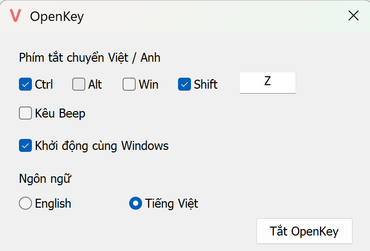

# OpenKey (bản đơn giản)

Bộ gõ tiếng Việt **siêu đơn giản** cho Windows: chạy ở khay hệ thống, chỉ có vài tùy chọn, không cần cấu hình gì thêm.

## Cách dùng

- **Bấm chuột trái** vào biểu tượng ở khay hệ thống để bật/tắt gõ tiếng Việt.
- **Bấm chuột phải** (hoặc nháy đúp) để mở cửa sổ cài đặt.
- Hoặc dùng **phím tắt** để chuyển nhanh giữa tiếng Việt và tiếng Anh.

## Cài đặt

Chỉ có 4 mục:

- **Phím tắt chuyển Việt / Anh**: chọn Ctrl, Alt, Win, Shift và (tùy chọn) một phím, ví dụ Ctrl + Shift + Z.
- **Kêu Beep**: phát tiếng bíp mỗi khi chuyển chế độ.
- **Khởi động cùng Windows**.
- **Ngôn ngữ** giao diện: English hoặc Tiếng Việt.

Các thiết lập khác (kiểu gõ Telex, bảng mã Unicode, kiểm tra chính tả...) được đặt sẵn mặc định và ẩn đi.

## Tải về

Vào tab **Actions** của repo, chọn lần chạy **MSBuild** mới nhất rồi tải `OpenKey` ở mục Artifacts (có bản x86 và x64).

## Nguồn gốc

Dự án này là bản rút gọn từ [OpenKey](https://github.com/tuyenvm/OpenKey) của Mai Vũ Tuyên, phát hành theo giấy phép GPL. Nếu bạn cần đầy đủ tính năng (gõ tắt, chuyển mã, nhiều kiểu gõ...), hãy dùng bản gốc.
